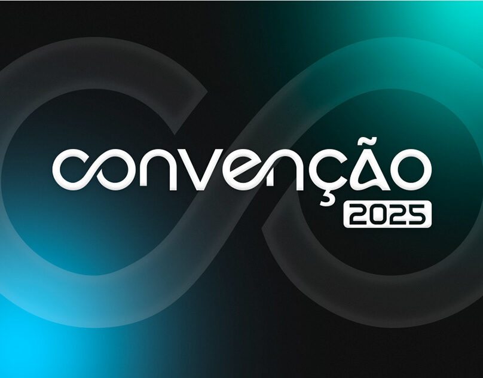
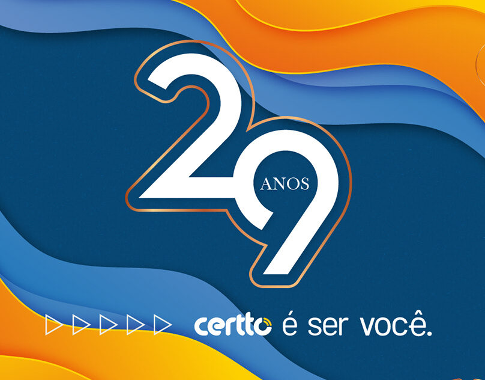
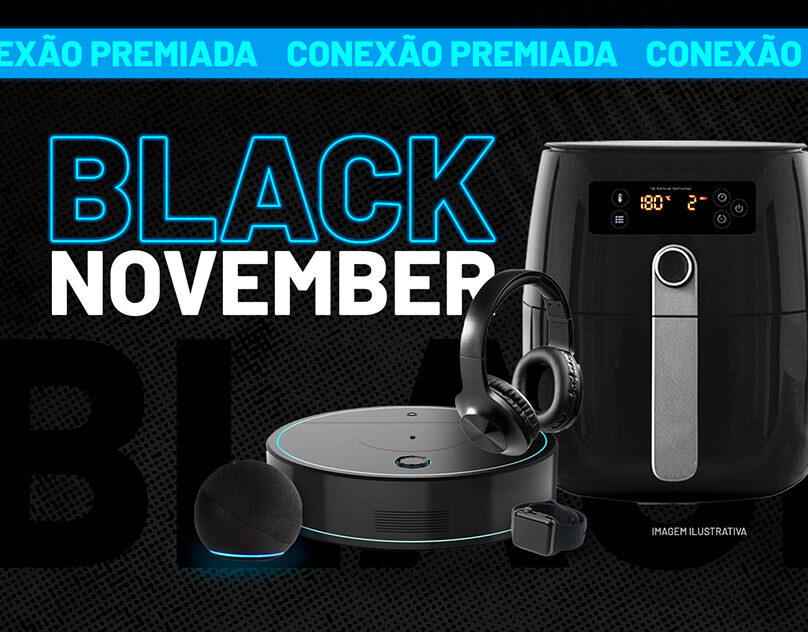
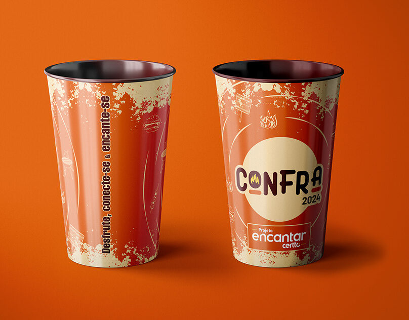
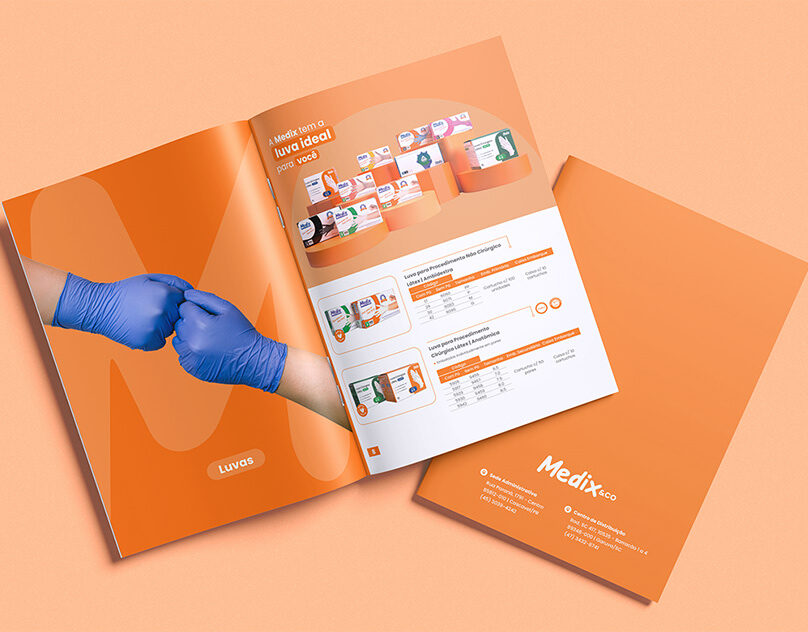

✳

<h1 align="center">Ana Paula Pinno</h1>

<b>Direção de Arte & Product Design</b>

Design pra fazer ideias acontecerem. 
Designer de Cascavel (PR). Do key visual à landing page publicada, cuido de cada etapa do caminho.

<a href="https://pinnodesign.github.io/"><b>Ver o portfólio →</b></a>

Design · Direção de arte · UX/UI

 

## ✳ Trabalhos selecionados

Ideias que saíram do papel.

### Digital · UX/UI & landing pages

**Gerador de assinaturas** · UX/UI 
A equipe gera a própria assinatura de e-mail, no padrão da marca, em menos de um minuto, sem depender do design.

**TruckPag Control** · Landing page 
Página do cartão corporativo que coloca o gestor de olho em cada gasto da equipe e leva direto pra conversa com um especialista.

**Abastecimento · Frota Leve** · Landing page 
Pra quem gerencia frota e quer controle de cada litro, nota e centavo, com a rede de postos num mapa interativo do Google Maps.

**O Prejuízo Invisível** · Landing page 
Isca digital que troca um e-book sobre o diesel que some sem ninguém ver pelo contato de quem gerencia a frota.

### Visual · Campanhas, eventos & identidade

<table>
  <tr>
    <td width="33%"> <b>Convenção 2025</b> Evento</td>
    <td width="33%"> <b>É ser você · 29 anos</b> Campanha</td>
    <td width="33%"> <b>Black November</b> Campanha de varejo</td>
  </tr>
  <tr>
    <td width="33%"> <b>Confraternização 2024</b> Evento</td>
    <td width="33%"> <b>Catálogo de produtos</b> Editorial</td>
    <td width="33%"></td>
  </tr>
</table>

 

## ✳ Sobre mim

**Do design gráfico ao produto digital.**

Formada em Publicidade, comecei no design gráfico, e foi lá que aprendi a olhar pra composição, tipografia e hierarquia antes de qualquer coisa.

Hoje uso esse repertório em produto digital: landing pages, interfaces e ferramentas, com Figma, IA e no-code no dia a dia.

> Design bonito importa. 
> Usabilidade também.

 

## ✳ Como eu trabalho

Processo sem mistério.

| | | |
|---|---|---|
| **01** | **Entender** | Briefing, público e objetivo antes do primeiro pixel. |
| **02** | **Desenhar** | Conceito, layout e sistema visual no Figma. |
| **03** | **Construir** | Do layout à página publicada, com Claude Code, IA e no-code. |
| **04** | **Ajustar** | Teste, feedback e ajuste fino até ficar redondo. |

 

## ✳ Caixa de ferramentas

O que eu uso pra fazer acontecer.

Figma · Design Systems · Prototipação · Claude Code · IA generativa · No-code · Photoshop · Illustrator · InDesign

 

## ✳ Contato

**Bora tirar sua ideia do papel?**

[E-mail](mailto:anapaulapinno145@gmail.com) · [LinkedIn](https://www.linkedin.com/in/ana-paula-pinno/) · [Behance](https://www.behance.net/designanapaulapinno) · [WhatsApp](https://wa.me/5545988168272)

 

© 2026 Ana Paula Pinno · Cascavel, PR

